# caro-ai-pvp

[](.github/workflows/ci.yml) [](#build-and-verify) [](#build-and-verify)

Mobile-first web arena for a custom gomoku variant played on 2 boards, a 16x16 grid and a side 12 hexagon. Play from a phone browser against a person or an increment-safe bot on server-hosted rooms, watch live rooms as a guest, step through match history with a playback board, and run bot vs bot tournaments on the same room surface with per-move engine telemetry and a decay-scaled rating.

## contents

1. [variant ruleset](#variant-ruleset)
2. [ui/ux features](#uiux-features)
3. [screenshots](#screenshots)
4. [grounding](#grounding)
5. [build and verify](#build-and-verify)
6. [repository layout](#repository-layout)
7. [diagrams](#diagrams)
8. [status](#status)
9. [roadmap](#roadmap)

## variant ruleset

Both boards share the same ruleset: 4 rules on top of gomoku.

- exactly 5 in a row along a line axis wins
- a line of 6 or more stones (an overline) never wins
- a line close-blocked at both ends by adjacent opponent stones is dead even when it holds 5
- red's second move must sit at distance 3 or more from red's first stone, Chebyshev distance on the square board, hex distance on the hexagon

Red moves first, the first legal 5 ends the game, a full board draws. Matches run as best-of 3, 5, 7, or 11 games over the 1+0, 2+1, 3+2, and 10+5 time controls, with the loser of a decisive game taking red next and a draw retaining red.

The square board is a 16x16 grid with 4 line axes. The hexagon board has side 12, 397 playable cells, coordinates A..W by 1..23, 3 line axes, and 6-neighbor threat dilation. The hexagon ships bookless, the opening book being a square artifact.

The engine tiers differ in thread count, transposition size, solver capabilities, book probe bound, and ponder width:

| tier | threads | tt | vcf | vct | book | ponder |
| --- | --- | --- | --- | --- | --- | --- |
| easy | 1 | no | no | no | no | no |
| medium | 2 | 32 MiB | yes | no | no | yes (1 thr) |
| hard | 4 | 128 MiB | yes | yes | no | yes (2 thr) |
| master | 6 | 768 MiB | yes | yes | yes (8 plies) | yes (4 thr) |
| grandmaster | 8 | 2 GiB | yes | yes | yes (16 plies) | yes (8 thr) |

Every tier always runs at full capacity. A request beyond the machine's core or memory budget waits or fails with a clear error. A bot room books the peak of a seat's search cores plus the opponent's ponder width. The tournament's worst-case transposition footprint stays inside the machine memory cap. Room creation reads the machine's available physical memory and rejects with a plain server-resources-full failure when it cannot fund the room's engines.

A series log opens with the pairing and 1 M-line per bot move, closes each game with its verdict and the series with its tally. Real lines from a 10+5 hard-tier series, with the `[BOOK]` and `[PONDER]` lines illustrative:

```
run 1 series 1
pairing hard-1 (hard) vs hard-2 (hard)
tc 10+5 bo3
M1, Red, H8, d=11, n=83.1m, nps=3.69m, ebf=5.2, tt=9%, hf=99%, fh1=90%, s=-300, thr=4, t=22.50, alloc=22.50, pv=H8 H6
M7, Red, F8, d=12, n=79.39m, nps=3.45m, ebf=4.5, tt=10%, hf=98%, fh1=92%, s=+3000, thr=4, t=22.98, alloc=22.98, pv=F8 F5 G8 E8 I8 J8 I7 J6 I6 I5 J7 J4 K3 G4
M15, Red, D8, d=9, n=177.09k, nps=60.67k, ebf=3.8, tt=0%, hf=0%, fh1=0%, s=M9, thr=4, t=2.92, alloc=23.55, [VCT], pv=D8 B10 E8 I8 E5 E9 F5 I5 D5
M31, Red, E9, d=7, n=129, nps=64.54k, ebf=2.0, tt=0%, hf=0%, fh1=0%, s=M7, thr=4, t=0.00, alloc=27.09, [VCF], pv=E9 E12 F10 B10 C7 G11 B6
M37, Red, B6, d=1, n=1, nps=1k, ebf=0.0, tt=0%, hf=0%, fh1=0%, s=M1, thr=4, t=0.00, alloc=36.52, [VCF], pv=B6
M1, Red, H8, d=0, n=0, nps=0, ebf=0.0, tt=0%, hf=0%, fh1=0%, s=+0, thr=4, t=0.00, alloc=22.50, [BOOK], pv=H8
M12, Red, H10, d=16, n=18m, nps=2.8m, ebf=2.0, tt=44%, hf=78%, fh1=91%, s=-25, thr=4, t=0.01, alloc=4.00, [PONDER], pv=H10 I9 J8 K7 J10
game 1: hard-1 (red) beat hard-2 (blue), 37 moves, won by 4
series hard-1 2-1
```

Notation: `d` search depth, `n` nodes, `nps` nodes per second, `ebf` branching factor, `tt` transposition hit rate, `hf` table occupancy, `fh1` first-move fail-high rate, `s` score in thousands from the mover's side or M# for a solver-proven mate in #, `thr` worker threads, `t` actual wall spent on the move, `alloc` the clock's budget draw for the move, `pv` the principal variation. The trailing tag names the producer: empty for a normal search, `[VCF]` and `[VCT]` for threat-solver proofs, `[BOOK]` for an opening-book reply, `[PONDER]` for an answer adopted from a ponder search run on the opponent's clock. A game verdict names the winner with its seats, the move count, and the winning shape (an open four here), and the series line carries the final tally.

Time controls 1+0, 2+1, 3+2, 10+5 each run the same PID-steered budget controller, the first 3 on bench-tuned gain rows and 10+5 reusing the 3+2 row: per-move grants spread the spendable remainder over expected moves left plus an increment share, steered against a planned drain trajectory, floored so a drained clock still funds minimum moves and a timeout can never decide a game.

## ui/ux features

| surface | capabilities | access |
| --- | --- | --- |
| login | login-or-create with timing-flat argon2id, seeded demo admin | public |
| home | player stats, live rooms grid, create-room form (time control, best-of, tier, board), live-run banner | public |
| lobby | quick-start create row (time control, best-of, opponent, board as segmented controls), live room cards with mini boards in play order, seat and tier chips, variant chips, spectator counts, join on open casual seats, watch into any live room | public, create and join signed-in |
| room | square 256-cell grid or hexagon 397-cell SVG live board with the seat cards, paired move list, series strip and controls railed beside it at wide widths, tabular ticking clocks and tier chips with the mover's card emphasized, rules-legal playable mask, tap ghost, bot M-line telemetry panel, ready and forfeit handshake | players; live stream public |
| terminal room | finished verdict state, mid-game reload restores the game | public |
| history | per-game score lines, turn counts, move previews | signed-in players |
| playback | paired numbered move list, first, prev, next, last, autoplay, jump-to-move from keyboard-focusable move buttons | the game's 2 players |
| profile | hero with rating, games, WLD bar and red/blue seat split, humans and bots records with per-tier bot rows, recent games with playback links | public |
| tournament | admin setup with config-bounded roster and board choice, live board per series, frozen leaderboard, stalled-run close | public read, admin drives |
| presentation | light pastel token layer (light pink page, 1 theme, color, type and space scales, 2 type voices: human prose and mono machine data), shared card, chip, field and button recipes, segmented controls for short option sets, amber reserved for live-attention data marks, accent-strong focus rings, 3:1 contrast floor on state-carrying boundaries, reduced-motion respected, 44px touch floor, 2-tap select-then-confirm on coarse pointers | all |
| install | PWA manifest with generated icon set, in-shell install action, offline fallback page; the service worker caches the static shell only and never answers api calls, the event stream, or live room and tournament state | all |

## screenshots

Every picture renders at a 440x956 portrait viewport on the light theme, numbered pairs with the square member left and the hexagon member right. The bot rooms, the hexagon tournament run, and both banners are real engine activity: playground/shots hosts real easy-tier bot-versus-bot rooms at 1+0 bo3 and a real 2-bot hexagon run, the operator polls the room endpoints and shoots at the stone thresholds, and terminal frames load before the finish so a retired room still holds its verdict.

#### P01, P02 home

The signed-in home with per-variant WLD stat rows, the live-run banner, and the rooms grid, then the create form's board control with the hexagon variant checked.

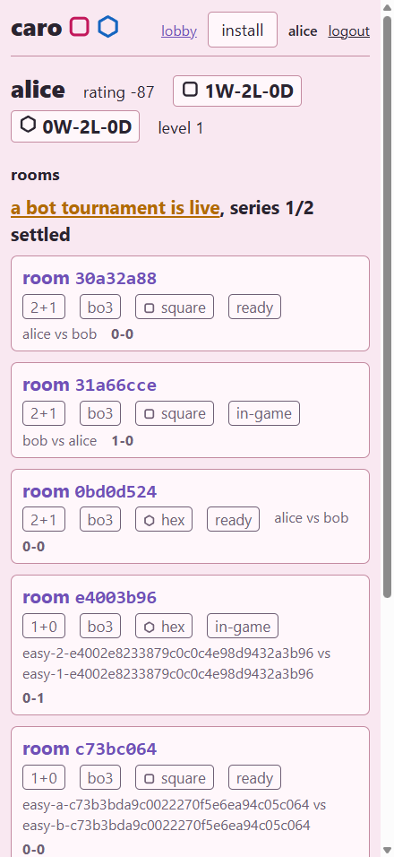 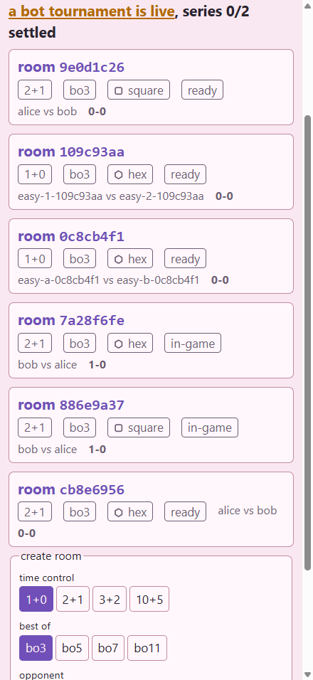

#### P03, P04 live rooms

Human rooms mid-game on both boards, the board the width hero beside the seat cards, clocks, and move list.

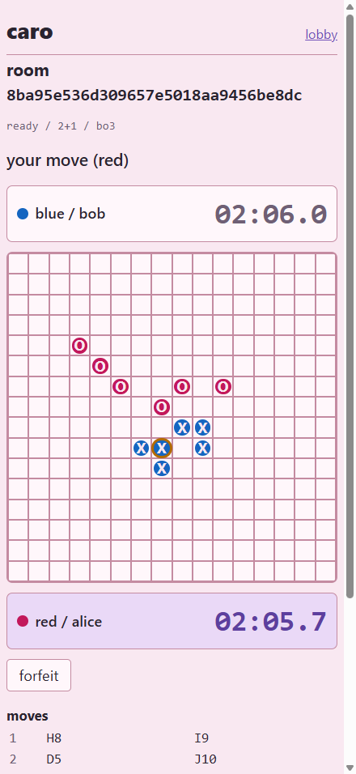 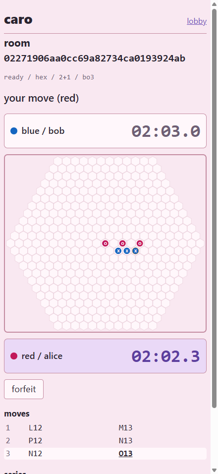

#### P05, P06 bot rooms

Real easy-tier bot-versus-bot games at 1+0 bo3 mid-play with real searches running, full-board games on both variants.

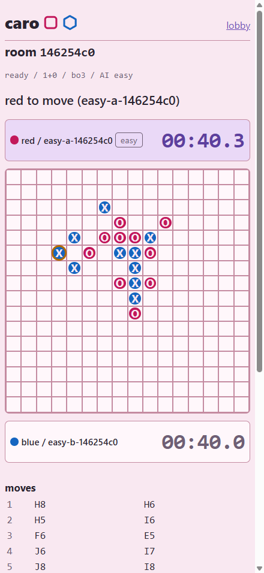 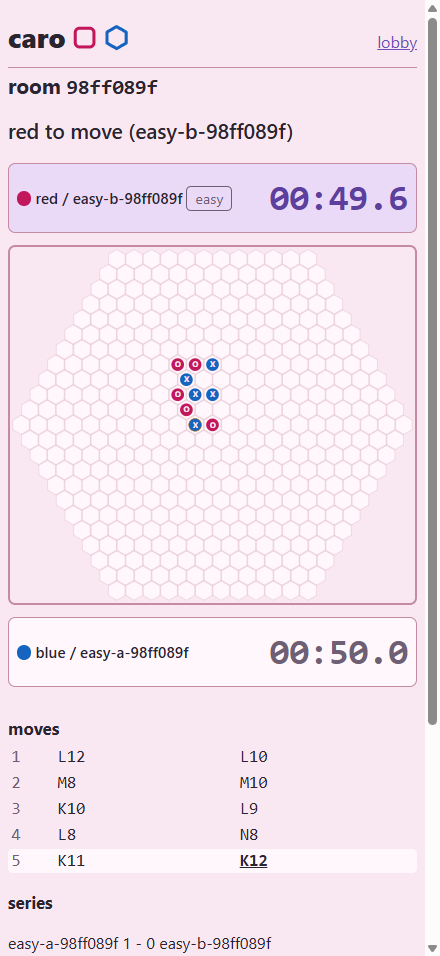

#### P07, P08 terminal rooms

Finished bo3 series holding the verdict on the open page after the room retired.

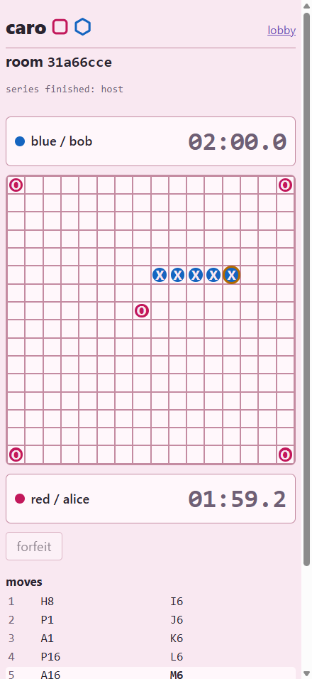 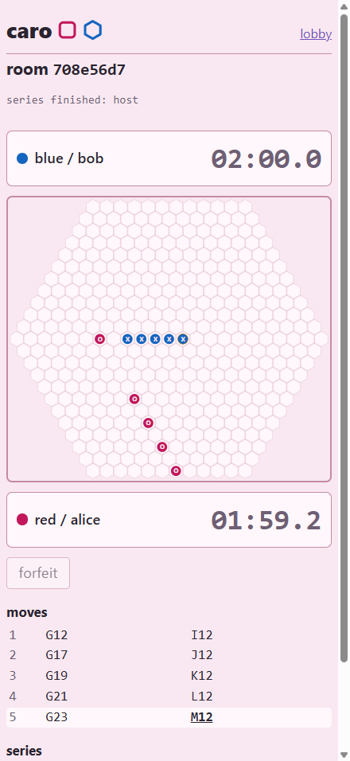

#### P09, P10 playback

Finished games stepped to the final position, the winning 5 visible beside the playback rail.

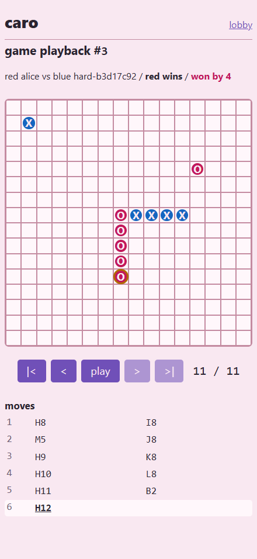 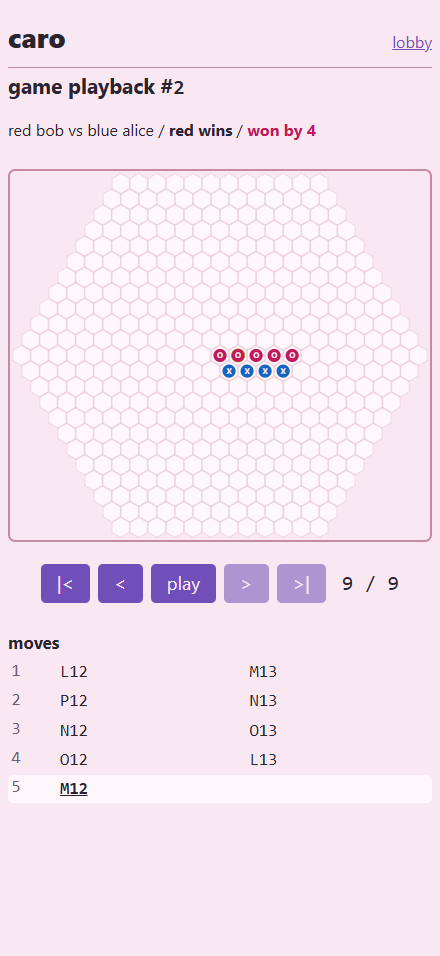

#### P11, P12 tournament run pages

The square run's frozen record with the filled square chip beside bo3 and the real 2-bot hexagon run's page with its live boards.

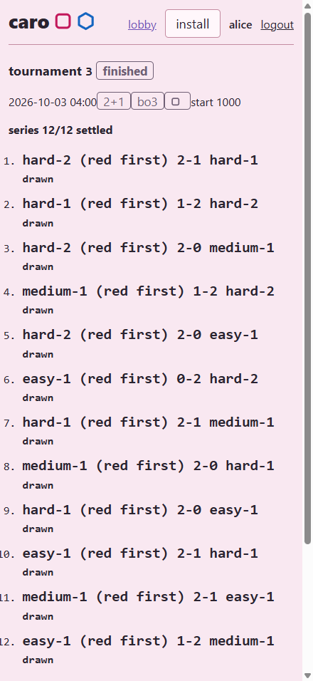 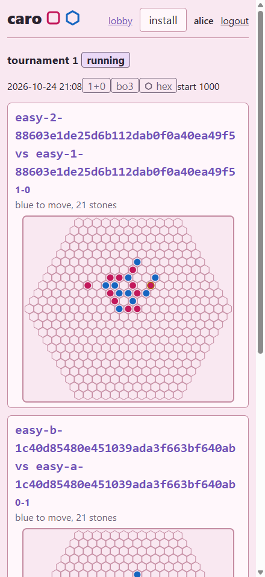

#### P13, P14 tournament live boards

The run page's live boards surface, 1 live bot card per member: P13 square-pure on the square run, P14 hexagon-pure on the real hex run.

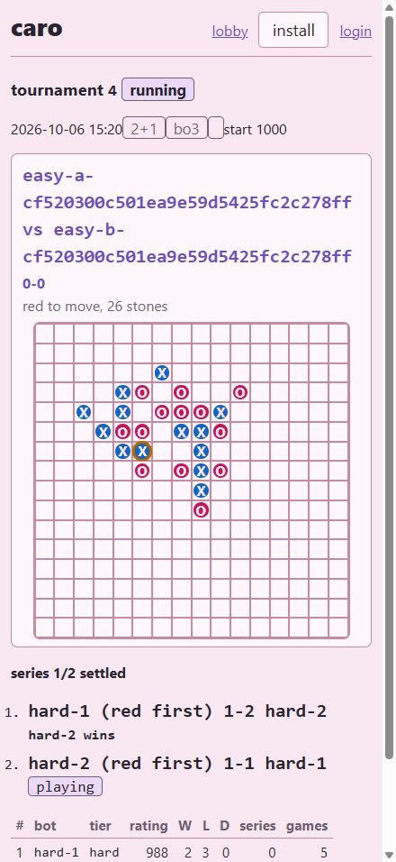 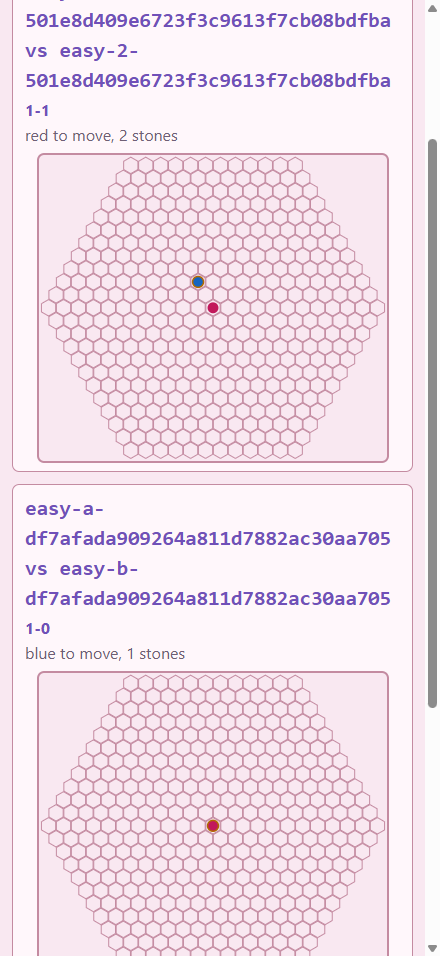

#### P15, P16 profiles

Public player pages with the rating hero, WLD bar, per-tier bot rows, and recent games; profile rows carry no variant naming.

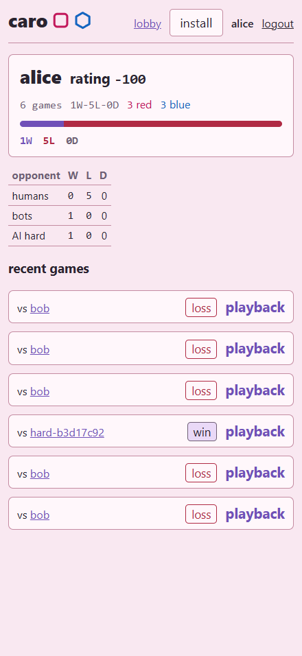 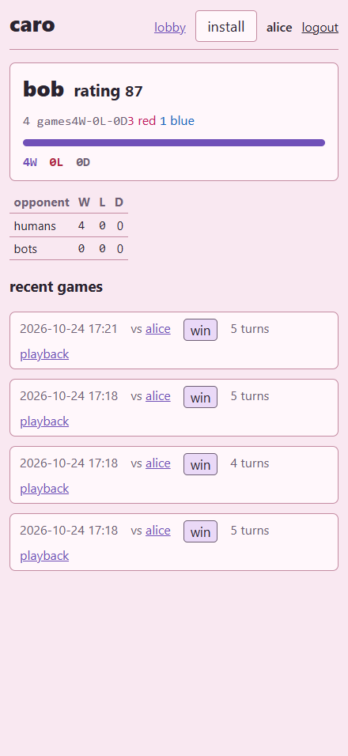

#### P17, P18 history

Per-game rows with turn-item move lists and status boxes, engine M-line tails on bot rows and both players' WLD on human rows.

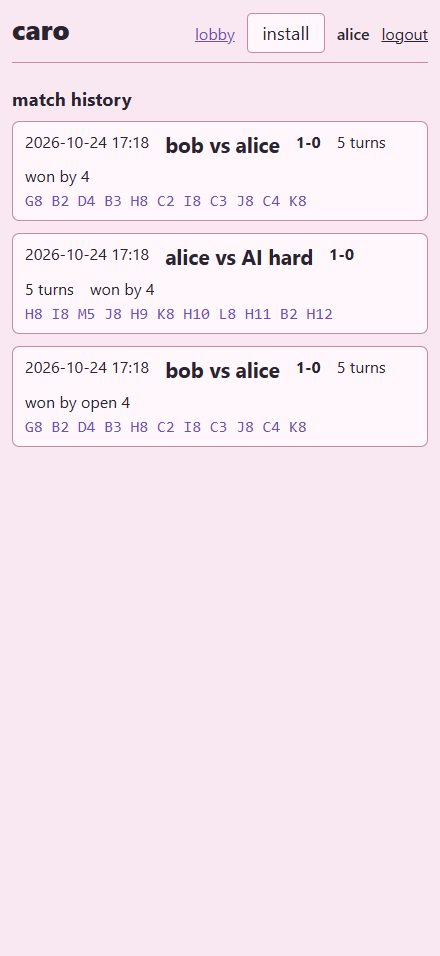 

#### P19, P20 lobby

The play-and-watch hub: quick-start create row over live room cards with mini boards and variant chips.

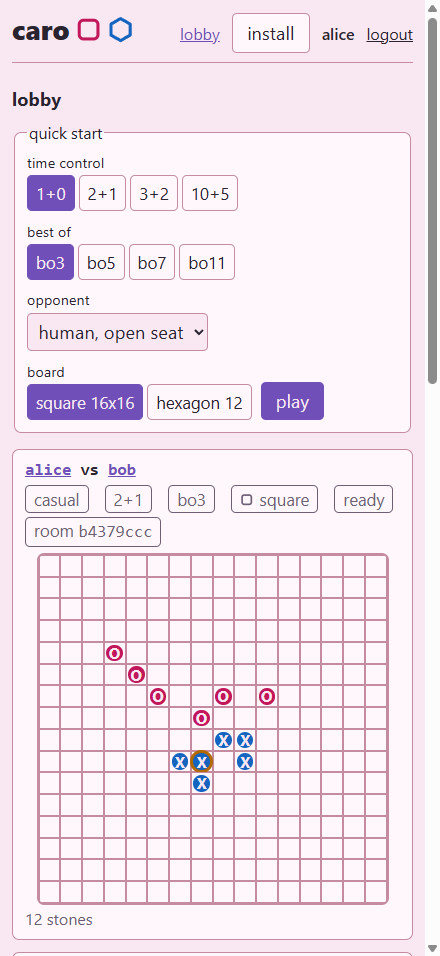 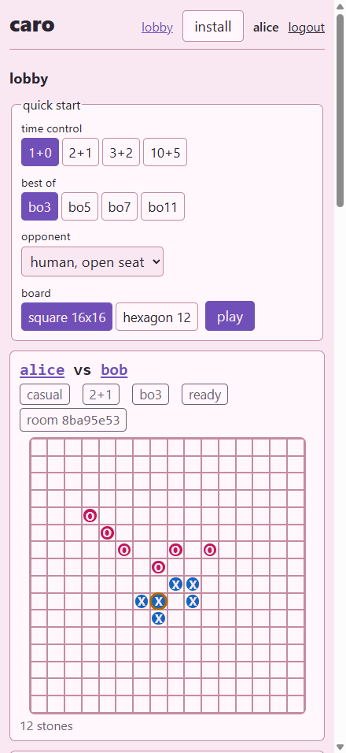

#### P21, P22 tournament setup

The admin setup with the config-bounded roster and the board choice segmented: square checked, then hexagon checked.

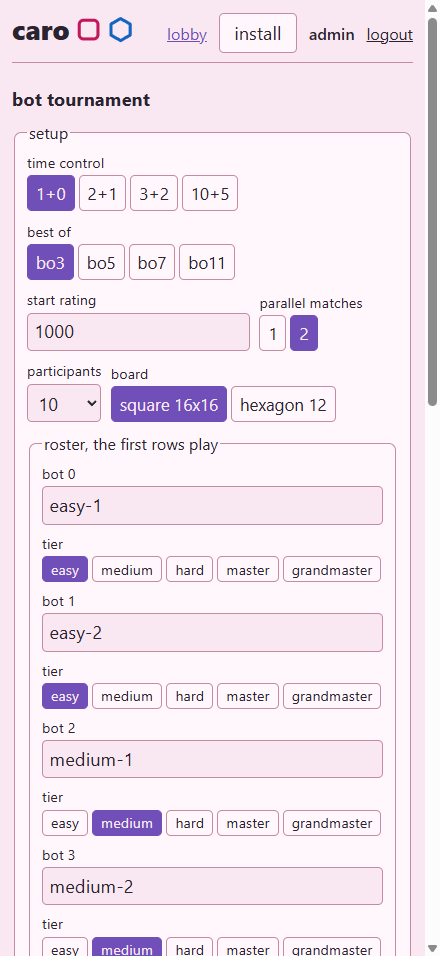 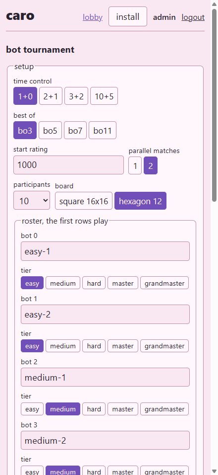

#### P23, P24 login and offline

The centered login-or-create card, and the PWA offline fallback served from the shell cache with the server process dead.

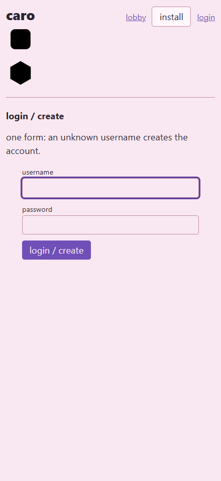 

#### P25, P26 live-run banners

The home banner over the square run and over the real hexagon run.

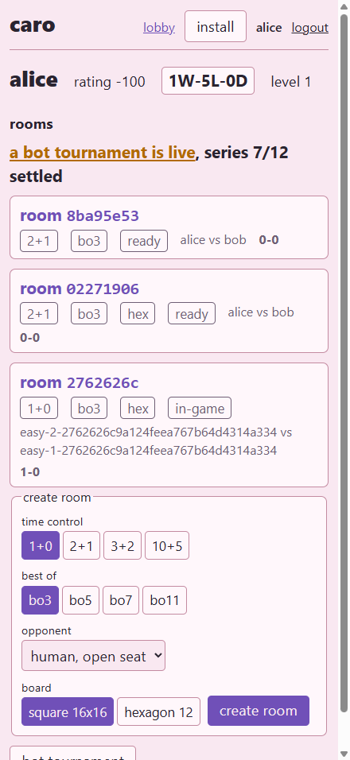 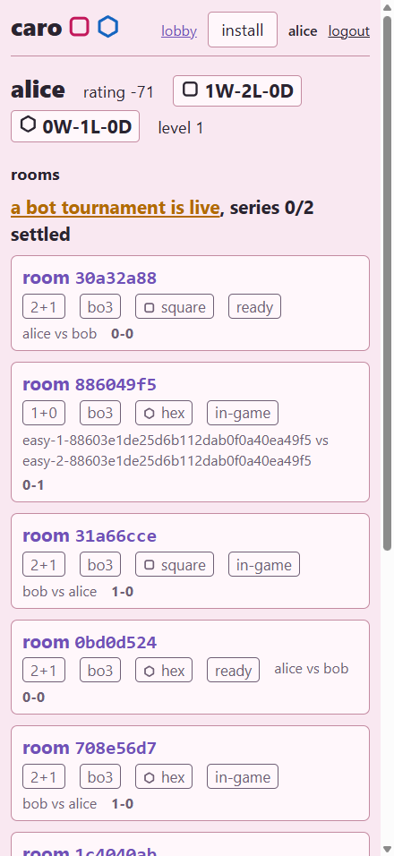

The capture contract, thresholds, and ordering live in [docs/design-system.md](docs/design-system.md).

## grounding

- [first-cause.md](first-cause.md): the founding spec, rules, hardware budget, and match scenarios.
- [docs/plans/first-cause-rebuild.md](docs/plans/first-cause-rebuild.md): milestone plan for the rebuild.
- ref/: offline chessprogramming.org and gomocup grounding.

## build and verify

Requires go 1.27.1+ and a C toolchain (gcc or llvm/clang), with CGO enabled.

```
go run ./cmd/run doctor          # toolchain check: go >= 1.27.1, CGO, gcc
go run ./cmd/run ci              # fmt-check, vet, build, race tests with coverage gates
go run ./cmd/run mutate-smoke    # rules-core mutation gate (runs in CI on every push)
go run ./cmd/run mutate-full LABEL=vX PARALLEL=4 CHALLENGE=1  # whole gate, auto-resumes host crashes; every test tree runs under a kernel-enforced 2 GiB commit cap so a broken-bound mutant dies in its own tree and 4 workers hold the 8 GiB mutation ceiling
go run ./cmd/run mutate-resume LOG=prior-run.log PARALLEL=4 CHALLENGE=1
go run ./cmd/run bench           # engine, clock, rules benchmarks with allocs
go run ./cmd/run fuzz            # rules differential fuzz target
go run ./cmd/run clocktune       # PID gain sweep for 1 time control, artifact under playground/clocktune/out/
go run ./cmd/run booktree-run    # detached tree-expansion book build, resumable from its expansion log
go run ./cmd/run bookval-short   # detached book validation arms (also bookval-confirm, bookval-cross), each resumable
go run ./cmd/run diagrams        # render the pngs from the puml sources
go run ./cmd/run logstats        # evidence report over the newest logs/tourny run
go run ./cmd/run db-checkpoint   # fold every db/*.db write-ahead log into its main file
go run ./cmd/run serve           # serve on the configured port, db under db/
```

Coverage gates: 95% overall, 100% on internal/rules, internal/engine, and internal/clock, read from the real suite's race coverage profile. The working tree keeps its artifacts placed: databases under db/, tournament logs under logs/tourny/, nothing database- or log-shaped in the root.

Mutation harness verdict laws: the unmutated suite must be green per package before any mutant is scored, a run that would execute nothing (full resume replay or a fully allowed population) skips that baseline, and only a real test exit can score a kill: infrastructure failures (spawn errors, missing shell, cap setup) void the whole run loudly instead of counting as kills. Parallel gates spread mutants round-robin over isolated module copies; survivors and challenge-flagged allowances are re-verified once serially, and worker-phase kills are load-trusted without re-verification, so kill-dominated populations scale near-linearly while any reported survivor is confirmed alone. Each test tree runs under a kernel memory cap, a Windows job object or a POSIX ulimit wrapper, and the cap wrapper must pass the command through intact: a dropped argv head turns every verdict into an instant fake kill.

## repository layout

```
cmd/caro          entrypoint (ports, firewall)
cmd/covergate     coverage gate over go cover profiles
cmd/mutate        in-house mutation gate (parallel, resume, challenge audit)
internal/config   single constants hub
internal/rules    board, legality, win detection (M1)
internal/pattern  exhaustive line-pattern tables (M2)
internal/engine   search core, SMP tiers (M3)
internal/vcf      VCF/VCT solvers (M4)
internal/clock    increment-safe time manager, per-TC PID (M5)
internal/server   store, auth, series and rating, write queue, rooms, htmx ui (M6)
internal/tourney  round robin, conductor, tournament store and logs (M7)
playground/       git-tracked R&D ground
docs/             rebuild plan, diagram sources and renders, screenshots
```

## diagrams

Sources are PlantUML under docs/diagrams, rendered to png by `go run ./cmd/run diagrams`.

#### search pipeline

1 pass per completed iteration: the soft stop is consulted at iteration heads only and only completed iterations become the answer.

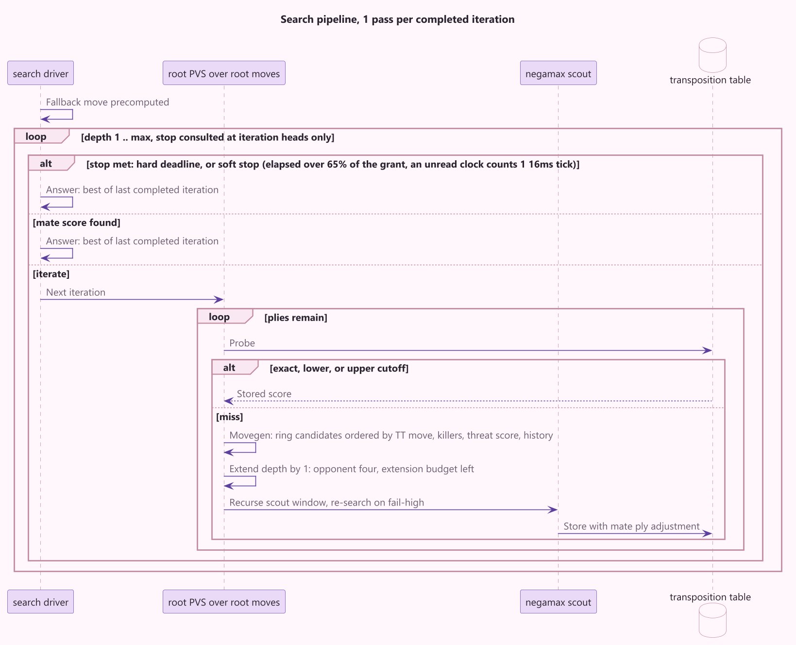

#### engine searcher stack

The searcher composition per seat: the book probe on book tiers, VCF and VCT solver wrappers, and the SMP engine of 1 locked-thread worker per core over the shared transposition table, with the ponder lane beside the main worker.

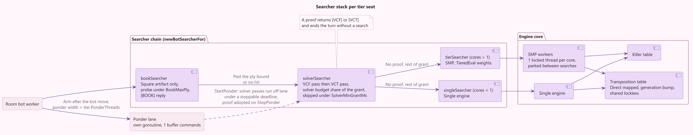

#### threat solver harness

The solvers generate only threat moves (fours for VCF, threes and fours for VCT) from the pattern tables, and the brute-force oracle fuzz cross-checks every claimed win in CI.

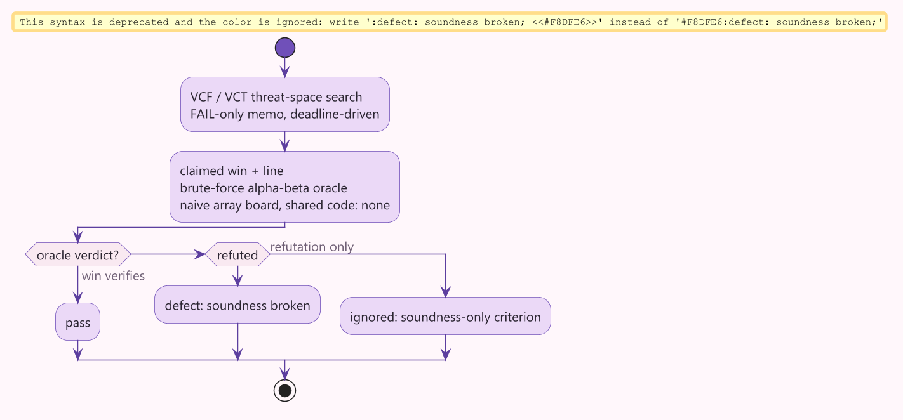

#### clock budget

The PID-steered controller draws the per-move budget, spreads it over expected moves left plus the increment share, steers against the drain trajectory, and floors the grant so a drained clock still funds minimum moves and a timeout can never decide a game.

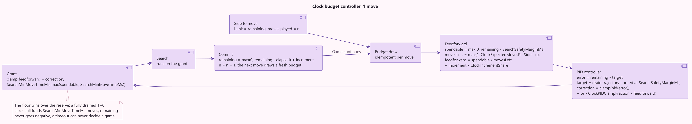

#### geometry seam

1 Geometry descriptor carries the square and hexagon boards through rules, pattern tables, engine, solvers, and rendering. The hexagon ships bookless.

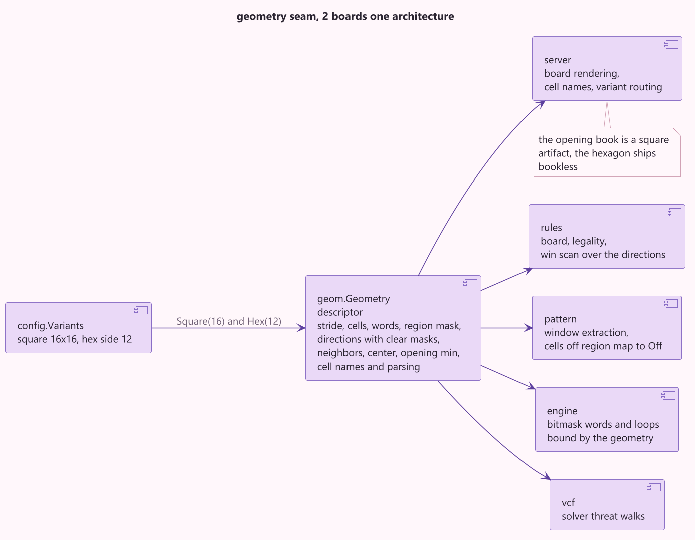

#### series state machine

The host takes red first, the loser of a decisive game takes red next, a draw retains red, and quitting books a loss for every remaining game.

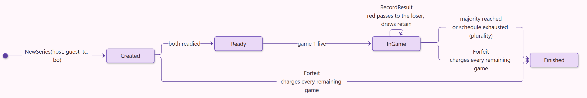

#### room lifecycle

Room create, seats joining, the ready handshake, the turn loop of human moves and bot searches, ponder armed on the opponent's turn, SSE events fanning out to players and spectators, and the retire to the terminal verdict.

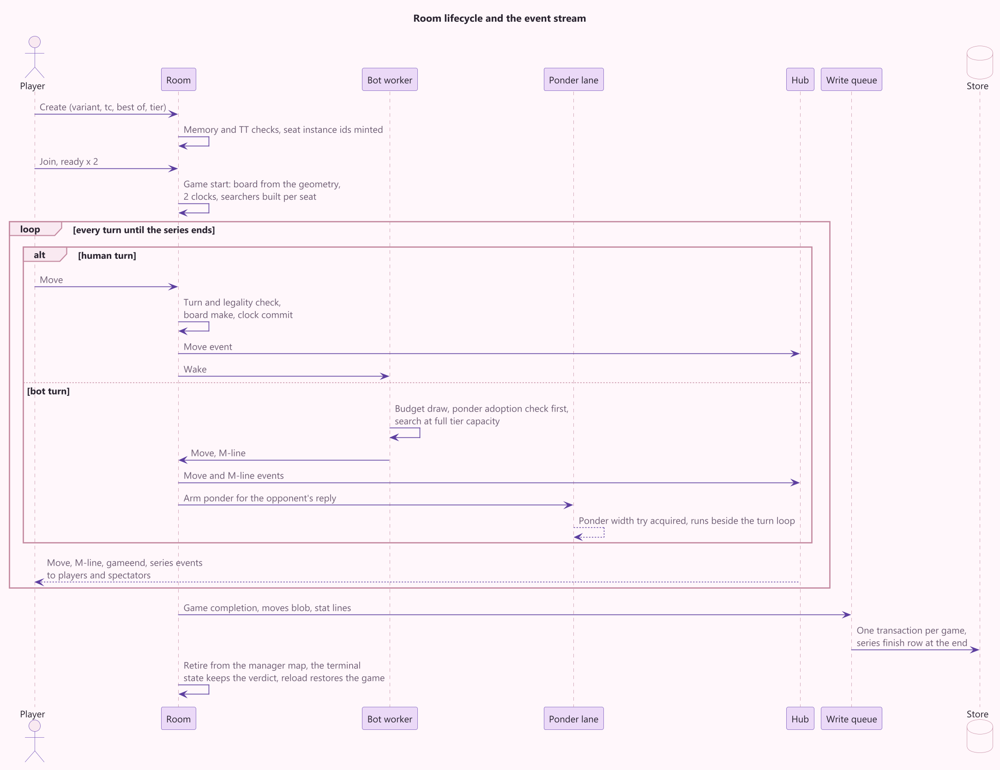

#### room data path

Gameplay never blocks on the disk: moves apply in memory, mutations queue to the single SQLite writer, and telemetry fans out to every subscriber.

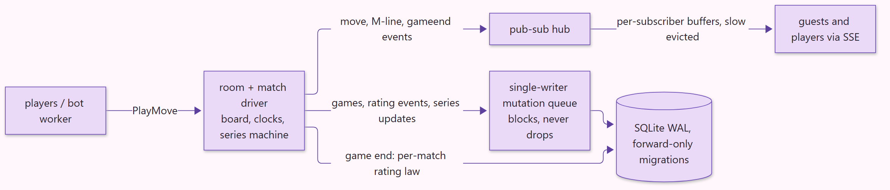

#### admission ledger

The machine-wide ledger acquires cores and transposition bytes at the search window, books the ponder width for the opponent's turn, and rejects room creation with a server-resources-full failure when the machine cannot fund the engines.

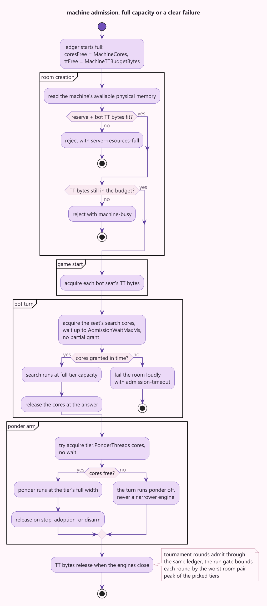

#### pwa shell

The service worker caches the static shell only, answers navigation network-first with the offline fallback, and never answers api calls or the event stream.

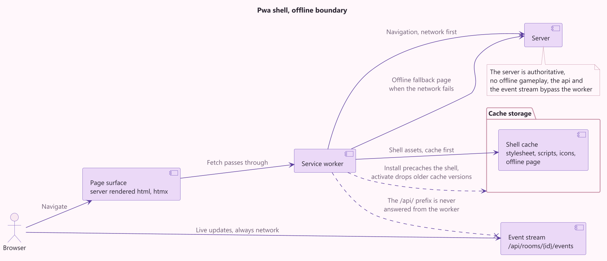

#### auth session

Login-or-create runs argon2id on an equal-work path for existing and new accounts, issues the session token, and verifies the seeded admin at boot.

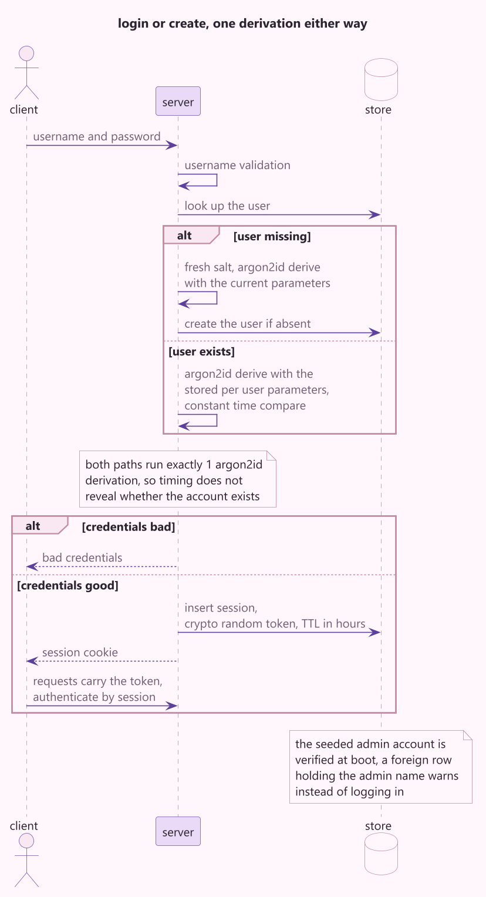

#### tournament conductor

Every series rides the same room surface a human match does: the conductor subscribes before the room can retire, reconciles each finished game against the authoritative move list, and fails the whole run on any divergence. 1 ongoing run at a time, per-run parallelism bounded by the tier cores, and only the admin starts or closes runs.

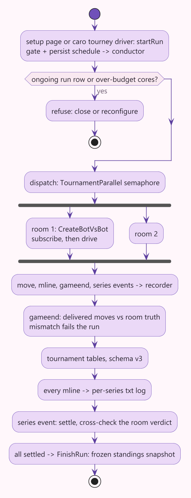

#### move stats

Every bot move is captured once as a structured record before its M-line renders, so the text line and the stored row are 2 views of 1 lossless capture.

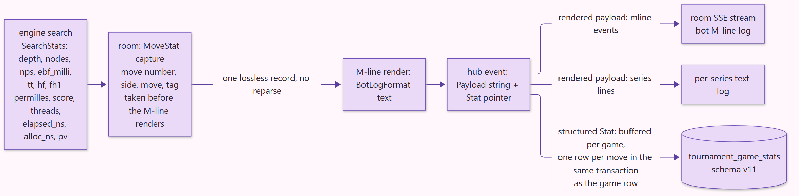

#### store schema

1 sqlite database carries the casual and tournament tables, the per-move telemetry in tournament_game_stats beside its game, and the PV stored space-joined as text.

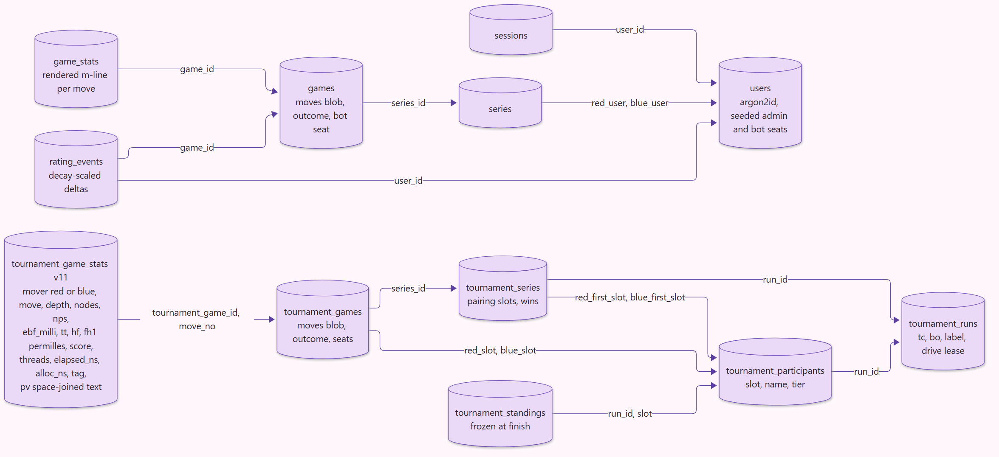

#### rating flow

Game completion writes the rating events, per-variant rating and WLD aggregate into the profile hero, the home stat lines, history rows, and playback deltas, and bot seats never carry a rating.

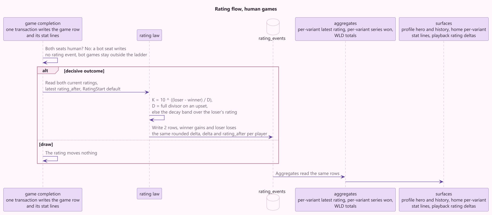

#### evalfit pipeline

Tournament games replay under integrity checks into window-class features fitted by monotone-chain gradient descent cross-checked by differential evolution, and the weights reach the config hub only after the arena gate passes.

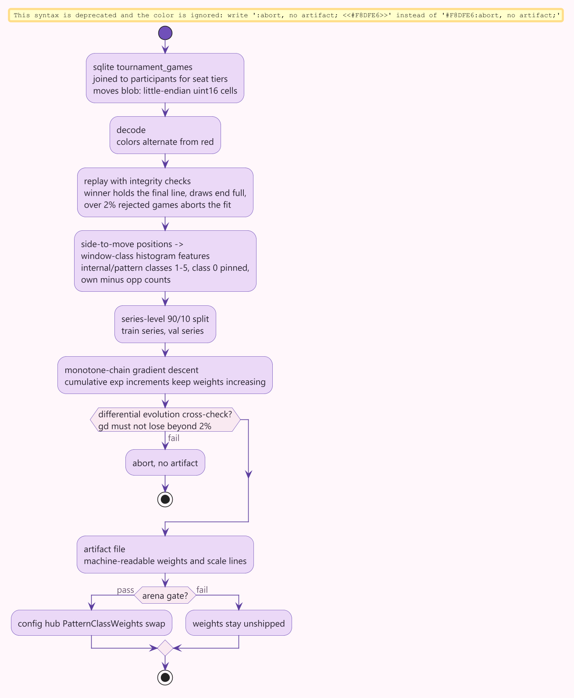

#### page surface

The shell and room pages are server-rendered html/template with vendored htmx 4, page routes mount beside the JSON API and win on their patterns, and the pure client functions ship as byte-pinned twins between the served JS and the Go tests.

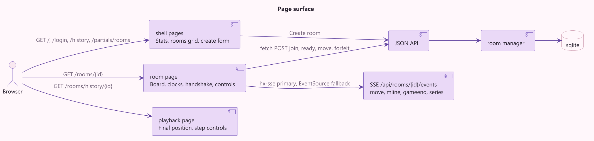

## status

Implemented:

- the 5-tier engine: fail-soft PVS over lazy SMP, VCF and VCT threat solvers with the brute-force soundness oracle in CI, pondering at each tier's width behind the 4-clause adoption gate, and the increment-safe clock over the 4 time controls
- the CAROBOOK1 book reader and searcher wiring, with the fixed-budget tree-expansion builder
- the hexagon variant on every playing surface, bookless
- the machine-wide admission ledger: full tier width or off, never a shrunken engine
- casual dual storage: every completion writes its series log as append-only text beside its sqlite rows
- verification: 95% overall and 100% core coverage gates on the race suite, mutation gates closed over rules, engine, clock, and server, the differential and soundness fuzz corpora in CI

The design record and the wave-by-wave log live in [devlog.md](devlog.md).

## roadmap

- v0.24 hexagon close: the hex gate chain verdict (master, master noise floors, the pass gates, ladder inversion checks at 2+1 and 3+2), then the full verification batch and the tag.
- v0.25 opening book: the fixed-budget tree-expansion build run, then the short, confirm, and cross validation arms, the master floors, and the strength gates rerun with the book in place (first 16 plies, entries backed by solver proofs or tree agreement over a visit floor, grandmaster probes 16 plies and master 8) before the tag.
- v0.26 pondering: the ponder arena pair (noponder versus pondering seats at the gated control) and the tag.
- v0.27 grandmaster pass gate: once the book and the weight chain land, grandmaster's W+D record across both red and blue seats must hold 2/3 or better versus master, 3/4 versus hard, 4/5 versus medium, and 9/10 versus easy, with screenshots from all supported flows including the ui-started tournament mid run with 2 grandmaster bots. Anything below is a strength anomaly and reopens the tier behind the inversion research law.
- v0.28 final close: full gates, the closing ladder round-robin over all 4 time controls with 0 inversions at 2+1, 3+2, 10+5 (1+0 recorded as thread-decided), README final state, evidence bundle, tag.
