# caro-ai-pvp

[](https://github.com/lavantien/caro-ai-pvp/actions/workflows/ci.yml) [](https://github.com/lavantien/caro-ai-pvp/actions/workflows/ci.yml) [](https://github.com/lavantien/caro-ai-pvp/actions/workflows/ci.yml)

Mobile-first web arena for a custom 16x16 gomoku variant. Play from a phone browser against a person or an increment-safe bot on server-hosted rooms, watch live rooms as a guest, step through match history with a playback board, and run bot vs bot tournaments on the same room surface with per-move engine telemetry and a decay-scaled rating. The behavior contract is scenario 1 in [first-cause.md](first-cause.md).

## contents

1. [variant ruleset](#variant-ruleset)
2. [ui/ux features](#uiux-features)
3. [screenshots](#screenshots)
4. [grounding](#grounding)
5. [build and verify](#build-and-verify)
6. [repository layout](#repository-layout)
7. [diagrams](#diagrams)
8. [status](#status)
9. [roadmap v0.21 to v0.30](#roadmap-v021-to-v030)

## variant ruleset

The game is a 16x16 gomoku variant with four rules on top of place-a-stone, alternate-turns play:

- exactly five in a row horizontally, vertically, or diagonally wins
- a line of six or more stones (an overline) never wins
- a line close-blocked at both ends by adjacent opponent stones is dead even when it holds five
- red's second move must sit at Chebyshev distance 3 or more from red's first stone

Red moves first, the first legal five ends the game, a full board draws. Matches run as best-of 3, 5, 7, or 11 games over the 1+0, 2+1, 3+2, and 10+5 time controls, with the loser of a decisive game taking red next and a draw retaining red.

Engine tiers are resource-only shapes of one search. This table is the demand spec set 2026-10-10: the sizes, the per-tier ponder widths, and the book ply bounds land in tree behind their gates, the ladder re-gate for the sizes and the arena pair for ponder, and the book column filled at v0.24 as one artifact probed to each tier's ply bound, then failed its strength gate at 3+2, so the artifact sits in tree pending the builder fix and regrow. The status section summarizes what is shipped today, with the wave-by-wave record in devlog.md.

| tier | threads | tt | vcf | vct | book | ponder |
| --- | --- | --- | --- | --- | --- | --- |
| easy | 1 | no | no | no | no | no |
| medium | 2 | 32 MiB | yes | no | no | yes (1 thr) |
| hard | 4 | 128 MiB | yes | yes | no | yes (2 thr) |
| master | 6 | 768 MiB | yes | yes | yes (8 plies) | yes (4 thr) |
| grandmaster | 8 | 2 GiB | yes | yes | yes (16 plies) | yes (8 thr) |

A series log opens with its pairing bookends and one M-line per bot move, closes each game with its verdict and the series with its tally. Real lines from a 10+5 hard-tier series, with the `[BOOK]` line real on the book tiers (the artifact sits in tree behind its failed strength gate) and the `[PONDER]` line an illustrative render of the adoption surface now live on master:

```
run 1 series 1
pairing hard-1 (hard) vs hard-2 (hard)
tc 10+5 bo3
M1, Red, H8, d=11, n=83.1m, nps=3.69m, ebf=5.2, tt=9%, hf=99%, fh1=90%, s=-300, thr=4, t=22.50, alloc=22.50, pv=H8 H6
M7, Red, F8, d=12, n=79.39m, nps=3.45m, ebf=4.5, tt=10%, hf=98%, fh1=92%, s=+3000, thr=4, t=22.98, alloc=22.98, pv=F8 F5 G8 E8 I8 J8 I7 J6 I6 I5 J7 J4 K3 G4
M15, Red, D8, d=9, n=177.09k, nps=60.67k, ebf=3.8, tt=0%, hf=0%, fh1=0%, s=M9, thr=4, t=2.92, alloc=23.55, [VCT], pv=D8 B10 E8 I8 E5 E9 F5 I5 D5
M31, Red, E9, d=7, n=129, nps=64.54k, ebf=2.0, tt=0%, hf=0%, fh1=0%, s=M7, thr=4, t=0.00, alloc=27.09, [VCF], pv=E9 E12 F10 B10 C7 G11 B6
M37, Red, B6, d=1, n=1, nps=1k, ebf=0.0, tt=0%, hf=0%, fh1=0%, s=M1, thr=4, t=0.00, alloc=36.52, [VCF], pv=B6
M1, Red, H8, d=0, n=0, nps=0, ebf=0.0, tt=0%, hf=0%, fh1=0%, s=+0, thr=4, t=0.00, alloc=22.50, [BOOK], pv=H8
M12, Red, H10, d=16, n=18m, nps=2.8m, ebf=2.0, tt=44%, hf=78%, fh1=91%, s=-25, thr=4, t=0.01, alloc=4.00, [PONDER], pv=H10 I9 J8 K7 J10
game 1: hard-1 (red) beat hard-2 (blue), 37 moves, won by 4
series hard-1 2-1
```

Notation: `d` search depth, `n` nodes, `nps` nodes per second, `ebf` branching factor, `tt` transposition hit rate, `hf` table occupancy, `fh1` first-move fail-high rate, `s` score in thousands from the mover's side or M# for a solver-proven mate in #, `thr` worker threads, `t` actual wall spent on the move, `alloc` the clock's budget draw for the move, `pv` the principal variation. The trailing tag names the producer: empty for a normal search, `[VCF]` and `[VCT]` for threat-solver proofs, `[BOOK]` for an opening-book reply, `[PONDER]` for an answer adopted from a ponder search run on the opponent's clock. A game verdict names the winner with its seats, the move count, and the winning shape (an open four here), and the series line carries the final tally.

Time controls 1+0, 2+1, 3+2, 10+5 each run the same PID-steered budget controller, the first three on bench-tuned gain rows and 10+5 on the 3+2 gains held provisionally: per-move grants spread the spendable remainder over expected moves left plus an increment share, steered against a planned drain trajectory, floored so a drained clock still funds minimum moves and a timeout can never decide a game.

## ui/ux features

The ui/ux table is the living surface inventory, rebuilt against the overhauled surfaces.

| surface | capabilities | access |
| --- | --- | --- |
| login | login-or-create with timing-flat argon2id, seeded demo admin | public |
| home | player stats, live rooms grid, create-room form (time control, best-of, tier), live-run banner | public |
| lobby | quick-start create row (time-control chips, best-of, opponent), live room cards with mini boards in play order, seat and tier chips, spectator counts, join on open casual seats, watch into any live room | public, create and join signed-in |
| room | 256-cell live board with the seat cards, paired move list, series strip and controls railed beside it at wide widths, tabular ticking clocks and tier chips with the mover's card emphasized, rules-legal playable mask, tap ghost, bot M-line telemetry panel, ready and forfeit handshake | players; live stream public |
| terminal room | honest terminal state, mid-game reload rehydrates | public |
| history | per-game score lines, turn counts, move previews | signed-in players |
| playback | paired numbered move list, first, prev, next, last, autoplay, jump-to-move from keyboard-focusable move buttons | the game's two players |
| profile | hero with rating, games, WLD bar and red/blue seat split, humans and bots records with per-tier bot rows, recent games with playback links | public |
| tournament | admin setup with config-bounded roster, live board per series, frozen leaderboard, stalled-run close | public read, admin drives |
| presentation | dark-first token layer (color ramps, type and space scales, two type voices: human prose and mono machine data), shared card, chip, field and button recipes, amber reserved for live-attention data marks, accent-strong focus rings, 3:1 contrast floor on state-carrying boundaries, reduced-motion respected, 44px touch floor, two-tap select-then-confirm on coarse pointers | all |
| install | PWA manifest with generated icon set, in-shell install action, offline fallback page; the service worker caches the static shell only and never answers api calls, the event stream, or live room and tournament state | all |

## screenshots

Dark-default captures at 390px phone and 1280px desktop widths, the primary presentation. The set is staged engine-free: the game, lobby, and profile surfaces through playground/uishots over a seeded store, the login, home, history, and tournament surfaces through playground/shots behind make shots over its seeded store and scripted tournament snapshots, with live rooms driven move by move and no search ever running, so captures never contend with the strength gates for the machine. The bot-room M-line log mid-game, the driven-run live boards and the finished leaderboard of a real run land with the v0.28 master pass gate, which requires screenshots from all supported flows on real systems. Login-or-create (an unknown name registers, the seeded admin row holds its name):

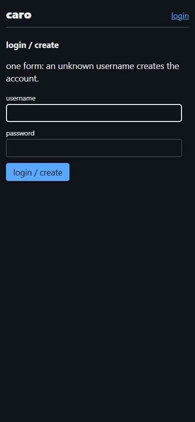

The guest home with the live rooms grid, then the logged-in home with the create-room form (time control, best-of, opponent tier from the config hub) and the banner headlining a live tournament while one is driven:

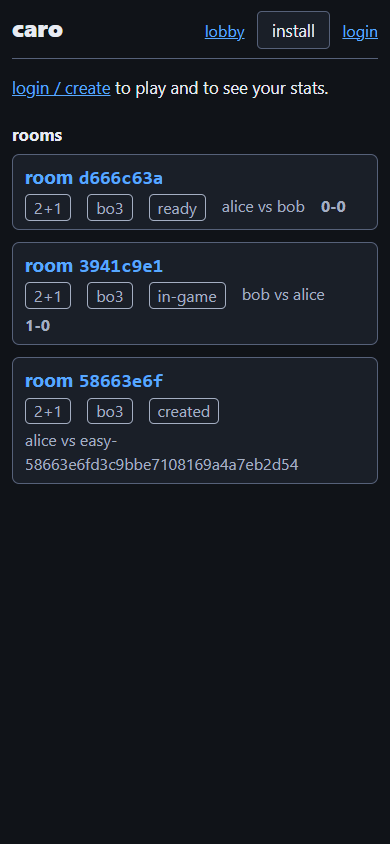

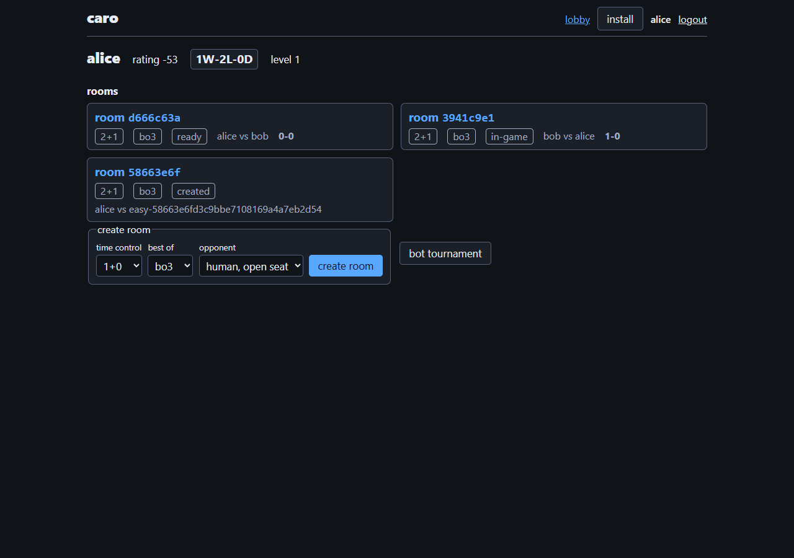

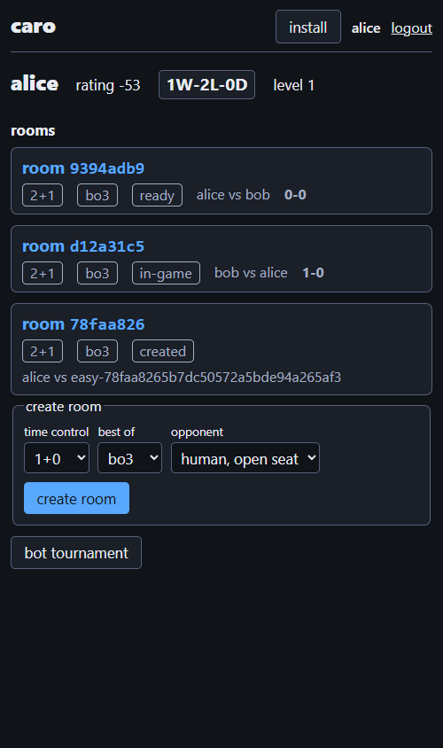

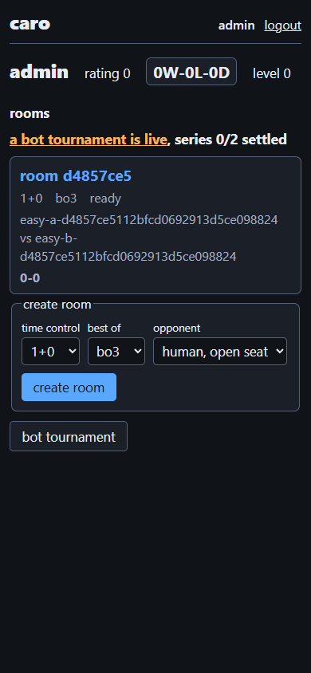

The lobby, the play-and-watch hub: the quick-start row (time-control chips, best-of, opponent) above live room cards, each card holding a mini board in play order, seat and tier chips, the spectator count, a join control on an open casual seat, and the watch link into the room itself:

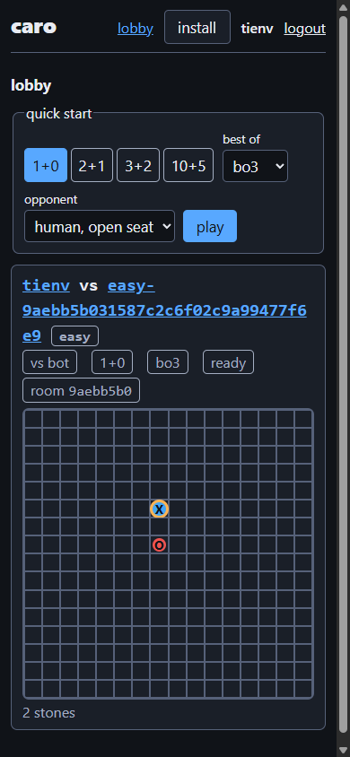

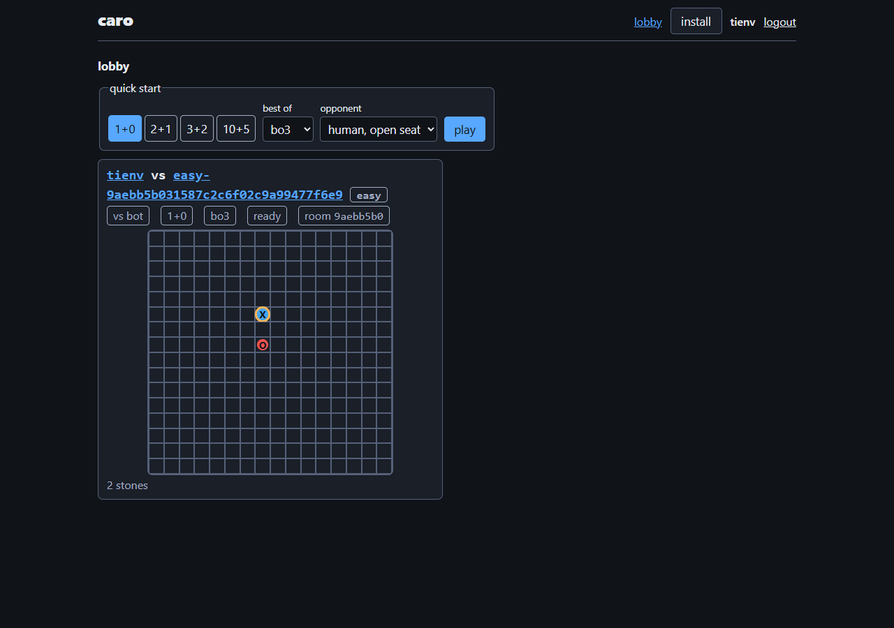

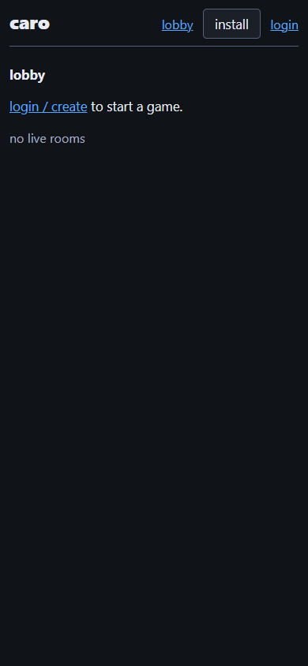

A live room mid-game on the player's side, phone stack and desktop board with its rail: turn call-out, seat cards with tabular clocks ticking between syncs and the mover's card emphasized, the paired numbered move list, the running series score, and the forfeit control:

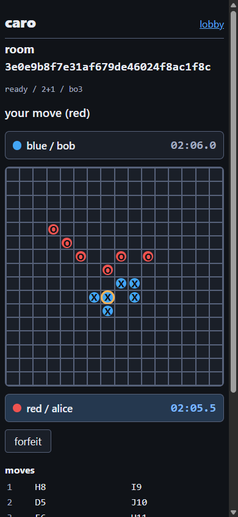

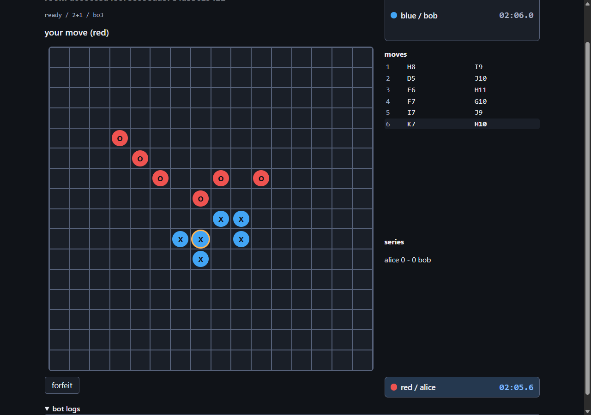

A bot room at the easy tier, the bot's seat card holding its name, tier chip and clock beside the player's:

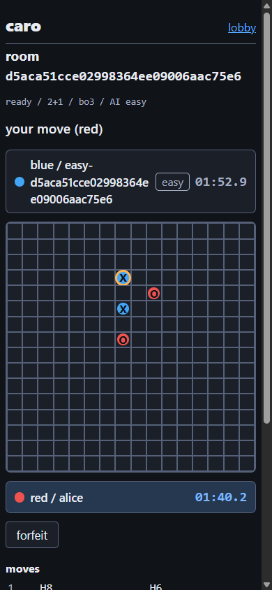

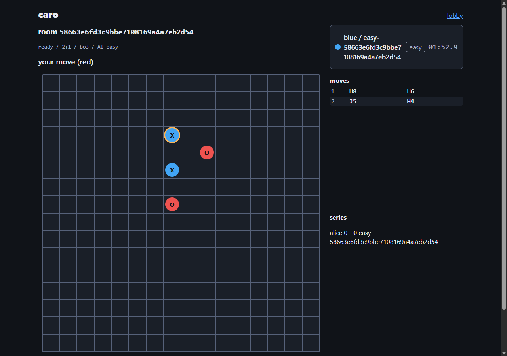

A finished series holds its verdict on the open page after the room retires:

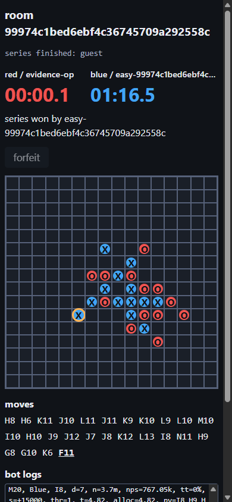

Match history with per-game score lines and move previews:

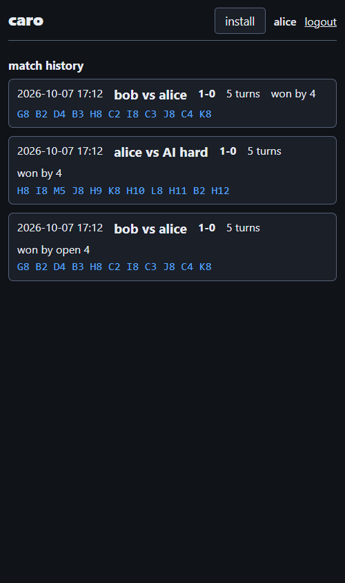

The playback page over a finished game, the board beside its rail: the verdict line, first to last with autoplay, and jump-to-move from the paired numbered list:

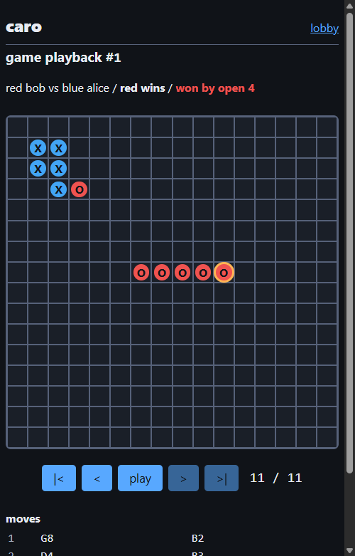

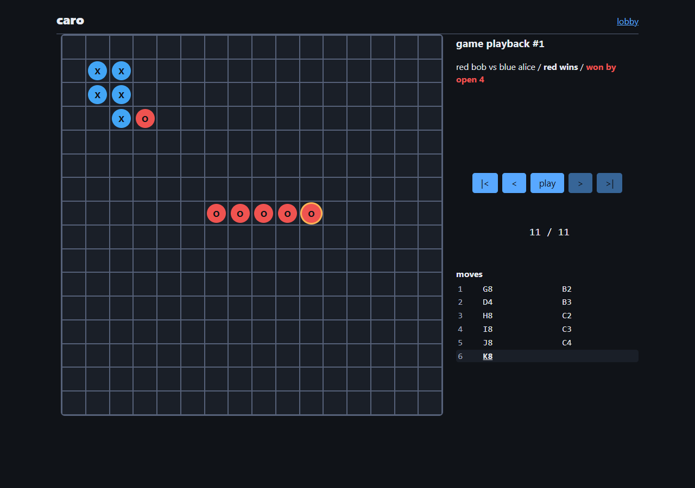

Player profiles, public per name: the hero with rating, games, the WLD bar and the red/blue seat split, the humans and bots records with per-tier bot rows, and recent games with playback links. The bot seat's profile carries its AI seat chip, an account without games holds its empty states:


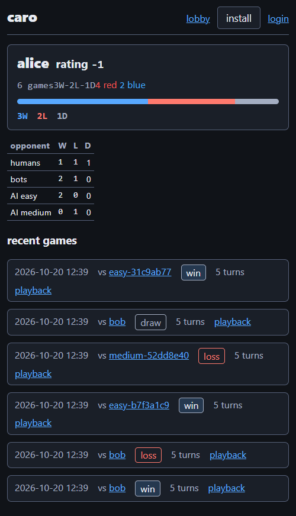

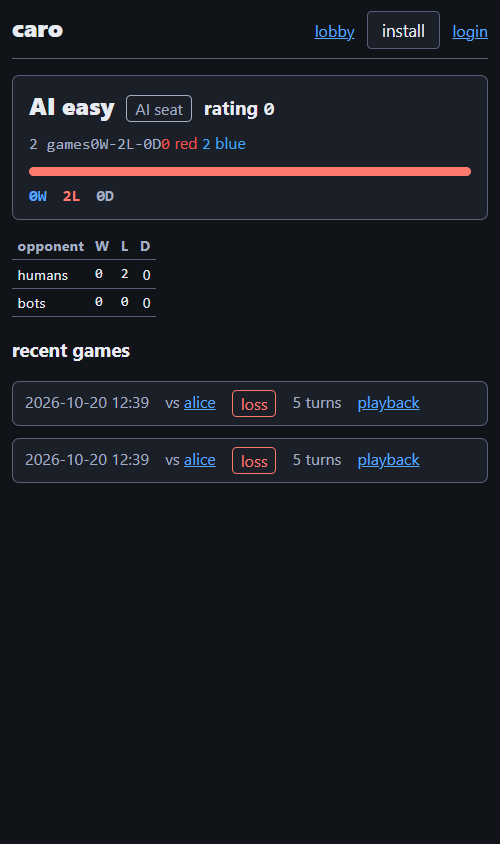

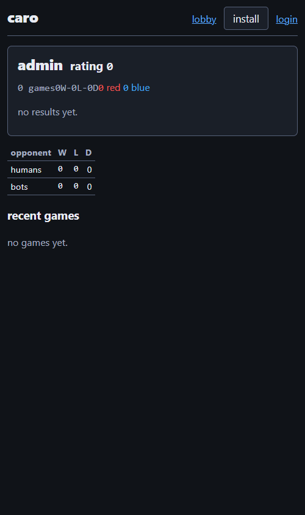

Tournament setup, admin-only: the config-bounded roster, tiers, time control, best-of, start rating and parallelism, with the run-gate close form for undriven runs:

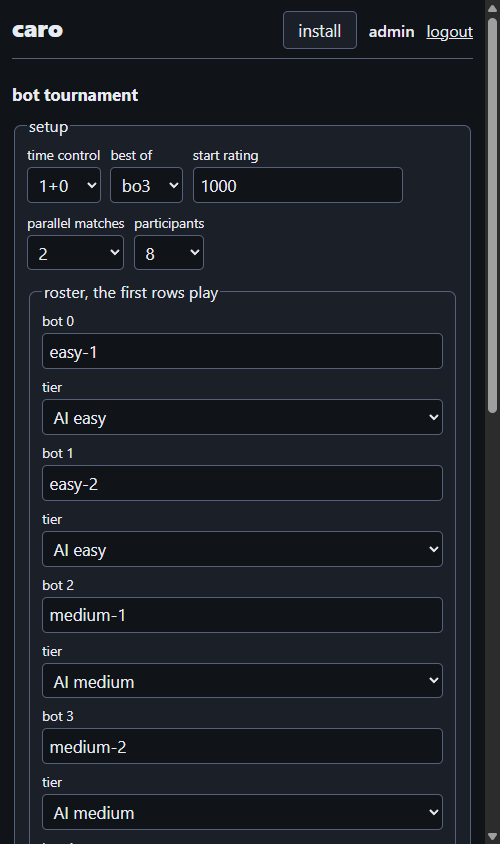

While the run drives, its page carries a live board per ongoing bot series in the room board's own style scaled into the card (stones in play order, score from red's side, the card links the room's own page), all public including guests:

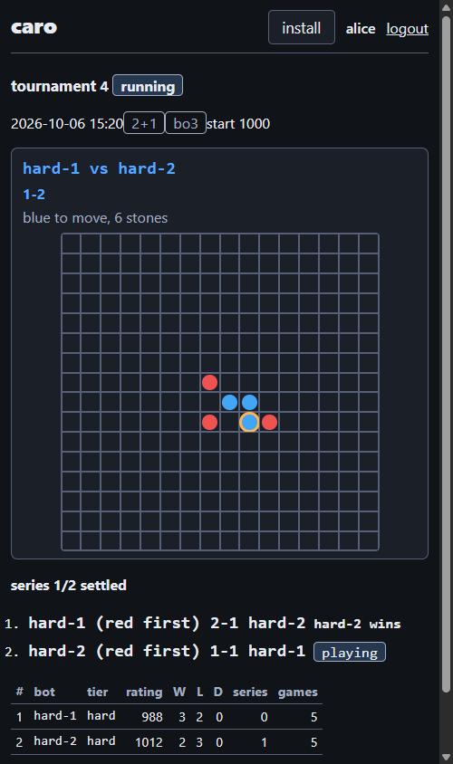

The finished run page with the frozen leaderboard:

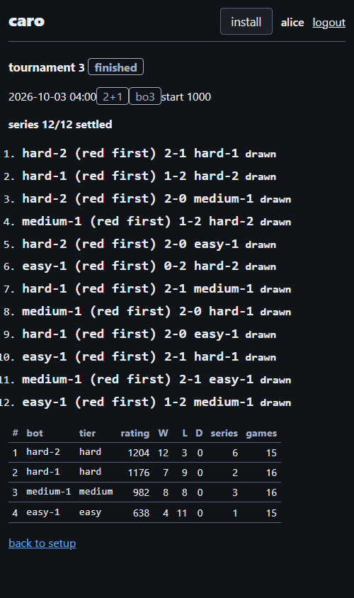

The login, logged-in home and banner, terminal room, history, and tournament captures are the prior set: those surfaces have no recaptured pair yet. The mobile pass audited every surface at 390x844: long room-id and bot-name tokens wrap or clamp instead of overflowing, controls hit the 44px touch floor under pointer:coarse, the board offers only the spaces the rules allow, a finished series holds its verdict on the open page, and the tournament leaderboard scrolls inside its own wrap.

## grounding

- [first-cause.md](first-cause.md): the founding spec, rules, hardware budget, and match scenarios.
- [docs/plans/first-cause-rebuild.md](docs/plans/first-cause-rebuild.md): milestone plan for the rebuild, updated as milestones land.
- ref/: offline chessprogramming.org and gomocup grounding, browser-sourced.

## build and verify

Requires go 1.27.1+, a C toolchain (gcc or llvm/clang), GNU make, with CGO enabled.

```
make doctor          # toolchain check: go >= 1.27.1, CGO, gcc
make ci              # fmt-check, vet, build, race tests, coverage gates
make mutate-smoke    # rules-core mutation gate (runs in CI on every push)
make mutate-full LABEL=vX PARALLEL=4 CHALLENGE=1  # whole gate, auto-resumes host crashes; every test tree runs under a kernel-enforced 2 GiB commit cap so a broken-bound mutant dies in its own tree and 4 workers hold the 8 GiB mutation ceiling
make mutate-resume LOG=prior-run.log PARALLEL=4 CHALLENGE=1
make bench           # engine, clock, rules benchmarks with allocs
make fuzz            # rules differential fuzz target
make clocktune       # PID gain sweep for one time control, artifact under playground/clocktune/out/
make diagrams        # render the dark PNG diagrams from the mermaid sources
make logstats          # evidence report over the newest logs/tourny run
make db-checkpoint     # fold every db/*.db write-ahead log into its main file
make serve             # serve on the configured port, db under db/
```

Coverage gates: 95% overall, 100% on internal/rules, internal/engine, and internal/clock. The working tree keeps its artifacts placed: databases under db/, tournament logs under logs/tourny/, nothing database- or log-shaped in the root.

Mutation harness verdict laws: the unmutated suite must be green per package before any mutant is scored, a run that would execute nothing (full resume replay or a fully allowed population) skips that baseline, and only a real test exit can score a kill: infrastructure failures (spawn errors, missing shell, cap setup) void the whole run loudly instead of counting as kills. Parallel gates spread mutants round-robin over isolated module copies; survivors and challenge-flagged allowances are re-verified once serially, and worker-phase kills are load-trusted without re-verification, so kill-dominated populations scale near-linearly while any reported survivor is confirmed alone. Each test tree runs under a kernel memory cap, a Windows job object or a POSIX ulimit wrapper, and the cap wrapper must pass the command through intact: a dropped argv head turns every verdict into an instant fake kill.

## repository layout

```
cmd/caro          entrypoint (ports, firewall)
cmd/covergate     coverage gate over go cover profiles
cmd/mutate        in-house mutation gate (parallel, resume, challenge audit)
internal/config   single constants hub
internal/rules    board, legality, win detection (M1)
internal/pattern  exhaustive line-pattern tables (M2)
internal/engine   search core, SMP tiers (M3)
internal/vcf      VCF/VCT solvers (M4)
internal/clock    increment-safe time manager, per-TC PID (M5)
internal/server   store, auth, series and rating, write queue, rooms, htmx ui (M6)
internal/tourney  round robin, conductor, tournament store and logs (M7)
playground/       git-tracked R&D ground
docs/             rebuild plan, diagram sources and renders, screenshots
```

## diagrams

Search pipeline, one pass per completed iteration. The soft stop is consulted at iteration heads only, and only completed iterations become the answer.

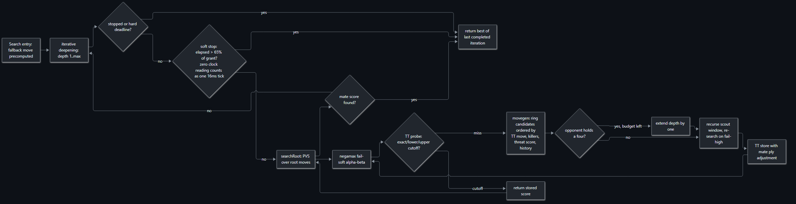

Lazy SMP wraps the same pipeline: one persistent locked-thread worker per core, parked between searches, all sharing one lockless direct-mapped transposition table; a worker's proven immediate win halts its siblings through a shared flag folded into their deadline.

Threat-solver soundness harness. The solvers generate only threat moves (fours for VCF, threes and fours for VCT) from the init-computed pattern tables; a test-only brute-force oracle over the independent naive board cross-checks every claimed win, and that fuzz runs in CI permanently.

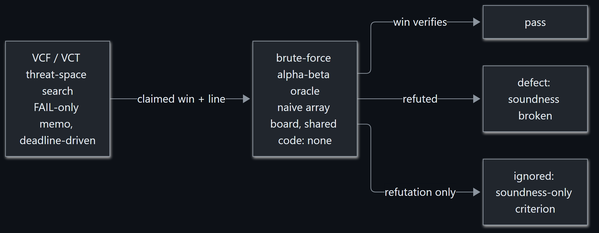

Series state machine inside every room. Host takes red first; the loser of a decisive game takes red next; a draw retains red; quitting books a loss for every remaining game.

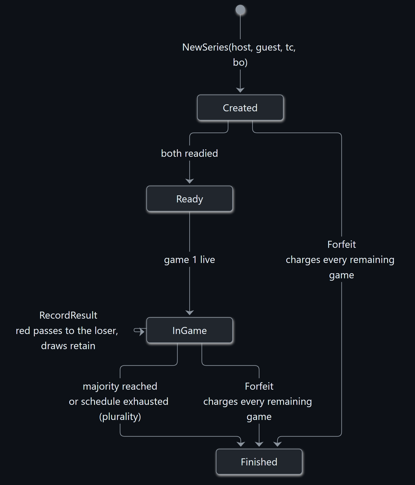

Room data path. Gameplay never blocks on the disk: moves apply in memory, mutations queue to the single SQLite writer, and telemetry fan out to every subscriber.

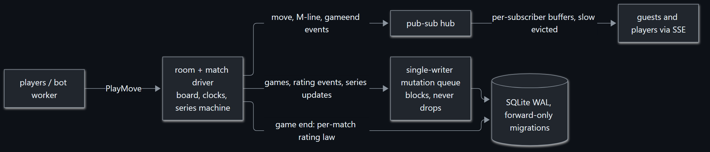

Move stats pipeline. Every bot move is captured once as a structured record before its M-line renders, so the text line and the stored row are two views of one lossless capture: the rendered payload reaches the SSE stream and the per-series text log, and the structured stat persists as one tournament_game_stats row per move, written in the same transaction as its game row under schema v11.

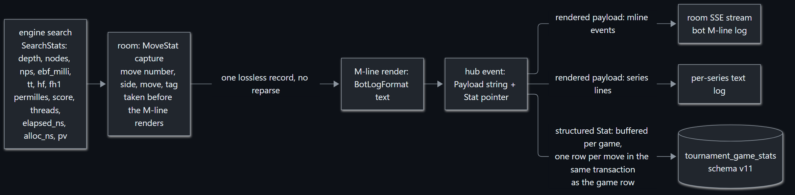

The tournament conductor. Every series rides the same room surface a human match does; the conductor subscribes before the room can retire, reconciles each finished game against the room's authoritative move list, and fails the whole run on any divergence.

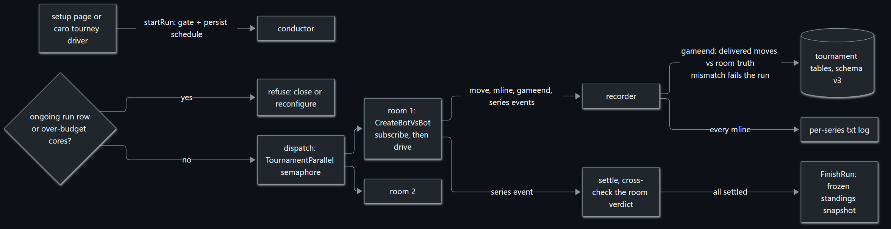

The machine-wide core budget is held by the run gate: one ongoing run at a time, per-run parallelism bounded by the tier cores, and an undriven run (stalled or failed) closed explicitly from its page before another can start. Starting runs and closing them is the seeded admin account's alone; every page, the setup list, the run boards, and the home's live-run banner read public, guest included.

Store schema. One sqlite database carries both sides: the casual tables behind human rooms and bot games, and the tournament tables behind the conductor, with the per-move telemetry in tournament_game_stats beside its game, mover red or blue per row, and the PV stored space-joined as text.

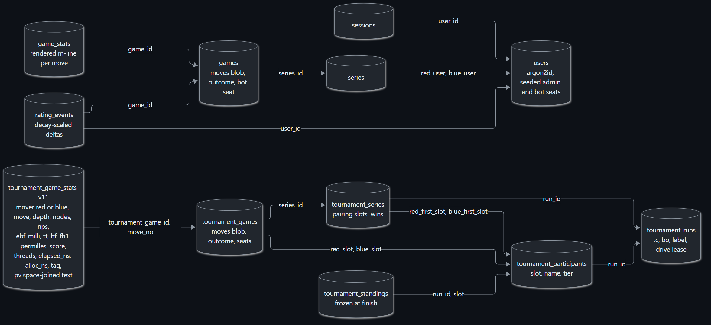

Evalfit pipeline. Tournament games decode from their move blobs and replay under integrity checks into side-to-move window-class features, fitted by monotone-chain gradient descent cross-checked by differential evolution. The artifact's weights reach the config hub's PatternClassWeights only after the arena gate passes, per the inversion research law.

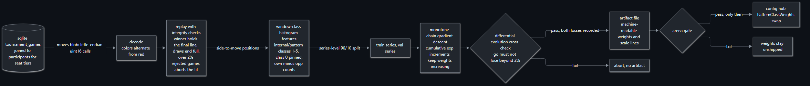

Page surface. The shell and room pages are server-rendered html/template with vendored htmx 4; page routes mount beside the JSON API and win on their patterns, everything else falls to the shell.

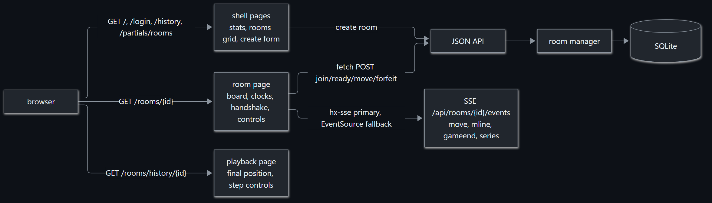

The pure client functions (tap-to-preview selection, the M-line UI filter) ship as byte-pinned twins: the same source is pinned between markers in the served JS and asserted byte-equal by Go tests, so the browser and the test suite cannot drift.

## status

The rebuild closed at v0.20 with the final issueless MVP. Landed since: v0.21 with the 10+5 control, v0.22 closed by the preregistered skip decision, and v0.23 the five-tier rescale, closed and tagged after its re-derivation round. The five-tier demand re-spec (grandmaster tier, sized master, per-tier ponder widths, book ply bounds) and pondering sit in tree, pondering behind its arena pair. The increment-axis investigation, the retire ordering law, and the ponder t-inflation fix closed on evidence with no tier constant moved. The internal/server mutation gate closed clean (1716/1716 run, 1638 killed, 0 survived, 78 allowed). The re-gate chain folded clean at both controls: the 2+1 read (playground/arena/out/regate-2plus1-gate.md) with rule 0 pass on every seat, both floors symmetric at 93 decisive games, rule A quiet in all 4 families, rule B certifying medium over easy; the 3+2 read (playground/arena/out/regate-3plus2-gate.md) with rule 0 pass on every seat, floors symmetric at 90 and 87 decisive games, rule A quiet in all 4 families, rule B unproven at this power exactly as the preregistered operating characteristics state. Rule C with zero fires across all 8 reads shipped the rescale tag v0.23 and closed the master tier's strength gate: the re-derivation found no inversion at either control. The internal/book artifact reader landed as v0.24 groundwork (218b976) with the stdlib bufio cap fix behind it, and the bookSearcher wiring merged after its adversarial pair (4469654): the artifact loads before any engine exists, construction failures surface as room errors with the room parked and releasable, the arena fails fast when a Book seat runs without a readable artifact, and master and grandmaster-nobook seats exist for the strength gates; book hits leave the ponder lane unarmed by their one-move PV, so ponder gate measurements run on the nobook seats. The ui overhaul landed: room and playback pages as a board with a rail (seat cards with clocks and tier chips, the mover's card emphasized, paired numbered move lists, jump-to-move playback), the lobby as a play-and-watch hub (quick-start create row, live room cards with mini boards, join, spectate into any live room), public player profiles (hero with WLD bar, seat split, humans and bots records with per-tier rows, recent games with playback links), and the PWA install shell with its offline boundary. The game, lobby, and profile surfaces carry dark-default captures at phone and desktop widths, the login, logged-in home, terminal, history, and tournament surfaces keep the prior captures until their recapture. The v0.24 book gate scored against its preregistered bands (playground/arena/out/v024-bookgate-verdict.md): the grandmaster 3+2 arm failed at a 0.368 book decisive fraction against the 0.447 floor lower bound, the 2+1 arm read inside band, the master arms stay descriptive because no master floor was ever committed, and the evalfit weights variant lost both controls so the base weights stand. The v0.26 admission ledger landed in tree: cores attach to the search window behind a bounded machine-wide wait that never grants partially, table bytes reserve at engine construction under the 8 GiB budget, ponder lanes fund the full tier width or arm off, tournament rounds admit through the same ledger, and a refused mid-series game start parks the room releasably instead of crashing the worker. The regrow window also banked its tooling and telemetry: the shard merge with segment-target semantics and the read-only corpus stats monitor in playground/bookgen, the floor-pool harness where the master floors are one command each in playground/arena, and the logmine mining over 214k logged moves that measured ponder adoption and hit rates (prediction correct 67 to 73 percent at every tier, the four-clause gate the binding constraint on converting hits) and triaged the easy depth cap as expected endgame behavior. Blocked: the ponder tag on the arena pair, the grandmaster tag on its strength gate, the v0.24 book tag on the builder fix and regrow. The implemented design record and the full wave-by-wave log live in [devlog.md](devlog.md).

## roadmap v0.21 to v0.30

v0.21 (10+5 time control) and v0.22 (TT round skipped by preregistered decision) are closed. v0.23 (the five-tier rescale) closed and tagged: the re-derivation round ran the preregistered re-gate chain, four floors plus three 2+1 repetitions plus one 3+2 arm, rule A stayed quiet in all 8 reads, so the demand re-spec of 2026-10-10 (five-tier shape, per-tier ponder widths, book ply bounds) shipped verified and the master tier's blocked strength gate closed with no tier constant moved. Every tier change rides the inversion research law the v0.20 program established: capability perturbation in the arena, self-play noise floors, and a ladder re-gate before any strength-bearing constant ships.

- v0.24 opening book (master and grandmaster): a committed hybrid-law book over the first 16 plies, entries backed by solver proofs or deep self-play agreement over a visit floor, built offline in playground and never hand-curated; grandmaster probes it to 16 plies and master to 8, replies land instantly tagged [BOOK], and the 40-of-40 red-first 1+0 floor is the case for it: at fast clocks the opening decides the game. The reader and wiring shipped and the strength gate failed at 3+2, so the wave reopens at the builder: regrow the corpus, commit a master floor or a preregistered master band derivation, and rerun the arms before the tag.
- v0.25 pondering: the pondering tiers (medium and up) search the predicted continuation on the opponent's clock at each tier's ponder width and adopt the tree only through the four-clause gated law (depth or time adequacy, best-move stability over recent iterations, no score drop beyond margin, no last-iteration change; solver proofs exempt), re-searching from scratch on a miss with the shared table keeping misses warm; adopted answers land tagged [PONDER]. Ponder budgets are machine time under an external stop, never the seat's own clock.
- v0.26 admission control: seat-aware reservation of threads and table bytes across rooms and ponder lanes under the machine-wide budget.
- v0.27 ui overhaul: the design system pass, PWA install shell, lobby and spectate browsing, player profiles, and the screenshot recapture of every surface against finished behavior.
- v0.28 grandmaster pass gate: grandmaster complete with the opening book at its ply bound, full-width pondering, full VCF/VCT, 8 threads, 2 GiB TT. Pass threshold, rungs binding by tier distance: grandmaster's W+D record across both red and blue seats must hold 2/3 or better versus master, 3/4 versus hard, 4/5 versus medium, and 9/10 versus easy; anything below is a strength anomaly and reopens the tier behind the inversion research law. Evidence includes screenshots from all supported flows on real systems, including the ui-started tournament mid run with 2 grandmaster bots.
- v0.29 reserve: consumed when an arena verdict fails its preregistered rule and demands a re-derivation round, or the runner migration produces the first timing flake.
- v0.30 final close: full gates, the closing ladder round-robin over all 4 time controls with zero inversions at 2+1, 3+2, 10+5 (1+0 recorded as thread-decided), README final state, evidence bundle, tag.

Concurrency and memory: an engine never runs below its tier's shape, no reduced parallelism, no width degradation on the search. The machine-wide core budget (MachineCores in the config hub, sized per machine, a budget decision rather than a hardware reading) holds every search at its full spec, and demand beyond it queues or fails loudly instead of shrinking the engine. Pondering holds the tier's spec'd ponder width through the opponent's turn (medium 1, hard 2, master 4, grandmaster 8 threads), so a bot room books the pair peak of one seat's search cores plus the other's ponder width: the ledger funds that peak or runs the game ponder-off, never a shrunken engine. The tournament's worst-case table footprint at the spec sizes (2x2 GiB grandmaster, 2x768 MiB master, 2x128 MiB hard, 2x32 MiB medium, easy tableless, about 5.8 GiB) stays inside the RAM/4 machine cap the same controller holds.
